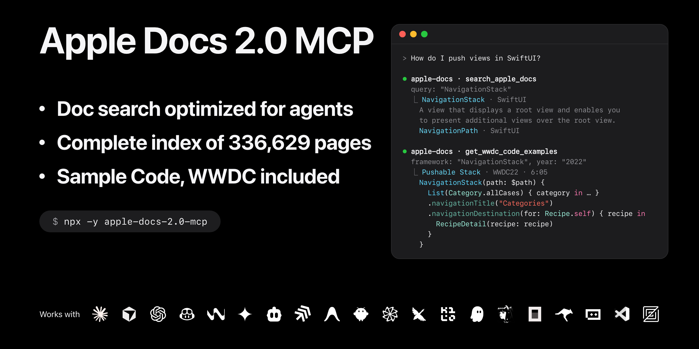

# Apple Docs 2.0 MCP - Apple 개발자 문서 Model Context Protocol 서버

[](https://opensource.org/licenses/MIT)
[](https://www.npmjs.com/package/apple-docs-2.0-mcp)
[](https://github.com/kimsungwhee/apple-docs-mcp)

Model Context Protocol을 통해 AI 어시스턴트에게 Apple 개발자 문서를 제공합니다: Claude, Cursor, VS Code 또는 모든 MCP 클라이언트에서 API 레퍼런스, 아티클, 샘플 코드, 튜토리얼, Human Interface Guidelines, App Store Connect 도움말, 웹 서비스 API(App Store Connect API, App Store Server API 등), 그리고 자막과 코드가 포함된 1,700개의 WWDC 세션을 활용할 수 있습니다.

Apple Docs 2.0 MCP는 [kimsungwhee](https://github.com/kimsungwhee)의 [Apple Docs MCP](https://github.com/kimsungwhee/apple-docs-mcp)를 포크한 프로젝트로, 기능 추가, 버그 수정 및 새로운 도구를 통해 개선되었습니다.

[English](README.md) | [日本語](README.ja.md) | **한국어** | [简体中文](README.zh-CN.md)

## 🆕 2.0의 새로운 기능

Apple Docs 2.0 MCP는 Apple Docs MCP 1.0.26의 모든 도구를 유지하면서 동작이 중단되었거나 불완전한 결과를 반환하던 문제를 해결하여, 어시스턴트가 추측 대신 Apple의 공식 문서를 바탕으로 답변하도록 합니다.

### 🔍 제대로 된 결과를 반환하는 검색

`search_apple_docs`가 수정되었습니다: 이제 Apple 웹사이트와 동일한 검색 서비스를 사용하여, 개발자가 developer.apple.com에서 보는 것과 같은 결과(API 레퍼런스, 아티클, 샘플 코드, 디자인 가이드라인, App Store Connect 도움말, WWDC 비디오)를 어시스턴트가 가져옵니다. 원본에서는 Apple이 검색 페이지를 변경한 이후 검색 결과가 비어 있었습니다.

API, 디자인 가이드라인 또는 App Store 절차에 대해 질문하면 어시스턴트가 먼저 검색한 후 찾은 페이지를 읽습니다.

### 🗺️ 이름으로 모든 페이지 조회

새로운 도구인 `search_docs_map`은 336,629개 페이지 중 원하는 페이지를 전체 이름 또는 일부 이름으로 오프라인에서 찾아줍니다:

- API 심볼: 타입, 메서드, 프로퍼티, enum case, 매크로
- 아티클, 튜토리얼 및 샘플 코드
- Info.plist 및 entitlement 키
- App Store Connect API와 같은 웹 서비스 엔드포인트
- Human Interface Guidelines 및 App Store Connect 도움말 페이지

코드나 에러 메시지를 통해 이미 이름을 알고 있을 때, 해당 페이지를 직접 열어보는 데 사용하세요.

### 📄 완전한 문서 페이지

Apple 사이트와 마찬가지로 페이지가 온전하게 제공됩니다: 단순한 `view`가 아닌 전체 시그니처(`var view: UIView!`)가 포함된 모든 메서드 및 프로퍼티, 해당 타입이 상속받거나 준수하는 대상, 관련 API, 지원 OS 버전이 모두 포함됩니다. 또한 2.0은 Human Interface Guidelines, 튜토리얼, App Store Connect 도움말, 그리고 파라미터 및 응답이 포함된 App Store Connect API 엔드포인트도 읽어옵니다.

어떠한 API, 가이드라인 또는 App Store Connect 주제에 대해 질문하더라도 어시스턴트가 전체 페이지를 먼저 읽은 후 답변하거나 코드를 작성합니다.

### 🎥 코드가 포함된 WWDC 2014–2026

WWDC26을 포함한 1,700개 세션이 내장되어 있어 오프라인에서 작동합니다: 1,416개 세션의 자막과 715개 세션의 코드 샘플이 제공되며, 각 샘플에는 영상에 나타나는 시점이 표시되어 있습니다. 세션들은 Apple 웹사이트와 동일한 주제별로 분류되어 있습니다.

새로운 API의 동작 방식을 물어보면, 어시스턴트가 해당 API를 소개한 WWDC 세션과 코드를 함께 인용할 수 있습니다.

### 📋 완전한 프레임워크 목록

원본에서는 기술 목록이 200개 항목 이후 끊겨 전체 카테고리(Graphics and Games, Media, System, Web)가 표시되지 않았으며, 심볼 검색 시 깨진 링크의 제목들이 뒤섞여 있었습니다. 2.0은 모든 항목을 나열하고 베타 상태인 프레임워크를 표시하며 주제별 프레임워크 검색을 지원합니다: "Machine learning"을 검색하면 Core ML, Create ML, Foundation Models, Vision 등이 반환됩니다.

머신러닝이나 오디오 같은 특정 작업에 적합한 프레임워크를 물어보면 어시스턴트가 전체 목록을 비교해 줍니다.

### 🛠️ 지속적인 동작을 위한 설계

최신 의존성 유지, 일반 브라우저처럼 보이면서 순서를 기다리는 요청 방식(Apple은 요청이 너무 빠르면 빈 검색 결과를 반환함), 요청 실패 시 자동 재시도, 그리고 255개의 자동화된 테스트를 갖추고 있습니다. 원본 README의 63개 사용 예시가 모두 오류 없이 실행됩니다.

추가로 설정할 사항이 없습니다: API 키나 계정이 필요하지 않습니다.

## ✨ 기능

- 🔍 **검색**: Apple 문서, 디자인 가이드라인, 샘플 코드, App Store Connect 도움말, WWDC 세션을 한 번에 검색하거나 개별 항목만 검색
- 🗺️ **문서 맵**: 네트워크 요청 없이 제목(메서드나 프로퍼티 이름 포함)으로 모든 페이지 검색
- 📚 **문서 페이지**: Swift 및 Objective-C API, 아티클, 튜토리얼, 웹 서비스 레퍼런스를 Markdown으로 제공
- 🎨 **Human Interface Guidelines**: 모든 HIG 페이지 검색 및 열람 가능
- 🏪 **App Store Connect 도움말**: 제품 페이지 필드, 심사, TestFlight, 가격 정책
- 🔧 **프레임워크 심볼**: 와일드카드를 사용해 프레임워크의 클래스, 구조체, 프로토콜 및 멤버 탐색
- 🔗 **API 관계**: 관련, 유사, 참조된 API 및 deprecated된 항목의 대체 API 확인
- 📊 **플랫폼 호환성**: 각 플랫폼에서 API가 도입 및 deprecated된 버전 확인
- 📋 **기술 카탈로그**: 카테고리별 모든 Apple 프레임워크 및 기술 목록 제공, 베타 버전 표시
- 📰 **문서 업데이트**: 릴리스 노트, 프레임워크 업데이트 및 WWDC "새로운 기능" 페이지
- 🎯 **기술 개요**: 앱 디자인, 게임, AI 및 머신러닝, 데이터 등에 관한 Apple의 가이드
- 💻 **샘플 코드**: 요약 및 다운로드 링크가 포함된 Apple의 샘플 프로젝트
- 🎥 **WWDC 라이브러리**: 자막, 시간 표시가 포함된 코드 예제, 리소스 및 관련 세션이 포함된 2014년부터 2026년까지의 1,700개 세션을 오프라인으로 제공

## 🚀 빠른 시작

요구 사항: jsdom 30에 필요한 Node.js 22(22.22.2 이상), 24(24.15 이상) 또는 26 이상.

### Claude Desktop (권장)

Claude Desktop 구성 파일에 다음을 추가하세요:

**macOS**: `~/Library/Application Support/Claude/claude_desktop_config.json`  
**Windows**: `%APPDATA%\Claude\claude_desktop_config.json`

```json
{
  "mcpServers": {
    "apple-docs": {
      "command": "npx",
      "args": ["-y", "apple-docs-2.0-mcp"]
    }
  }
}
```

> **참고**: 이전 버전이 사용되는 문제가 발생하면 `@latest`를 추가하여 최신 버전을 강제합니다:
> ```json
> "args": ["-y", "apple-docs-2.0-mcp@latest"]
> ```

Claude Desktop을 재시작하고 Apple API에 대해 질문해보세요!

### Claude Code

```bash
claude mcp add apple-docs -- npx -y apple-docs-2.0-mcp
```

## 📦 설치

<details>
<summary><strong>📱 Claude Code</strong></summary>

```bash
claude mcp add apple-docs -- npx -y apple-docs-2.0-mcp
```

[📖 Claude Code MCP docs](https://docs.anthropic.com/en/docs/claude-code/mcp)

</details>

<details>
<summary><strong>🖱️ Cursor</strong></summary>

`~/.cursor/mcp.json`에 추가하세요:

```json
{
  "mcpServers": {
    "apple-docs": {
      "command": "npx",
      "args": ["-y", "apple-docs-2.0-mcp"]
    }
  }
}
```

[📖 Cursor MCP docs](https://docs.cursor.com/context/mcp)

</details>

<details>
<summary><strong>🔷 VS Code</strong></summary>

VS Code의 이식 가능한 형식인 워크스페이스 루트의 `.mcp.json`에 추가하세요:

```json
{
  "mcpServers": {
    "apple-docs": {
      "command": "npx",
      "args": ["-y", "apple-docs-2.0-mcp"]
    }
  }
}
```

[📖 VS Code MCP docs](https://code.visualstudio.com/docs/copilot/chat/mcp-servers)

</details>

<details>
<summary><strong>⚡ Zed</strong></summary>

Zed의 `settings.json`에 추가하세요:

```json
{
  "context_servers": {
    "apple-docs": {
      "command": "npx",
      "args": ["-y", "apple-docs-2.0-mcp"],
      "env": {}
    }
  }
}
```

[📖 Zed MCP docs](https://zed.dev/docs/ai/mcp)

</details>

## 💬 사용 예시

### 🔍 검색
```
"SwiftUI 애니메이션 검색해 줘"
"withAnimation API 문서 찾아줘"
"Human Interface Guidelines에서 탭 바 검색해 줘"
"App Store Connect 도움말에서 TestFlight 외부 테스터 검색해 줘"
"Core Data 샘플 코드 찾아줘"
```

### 🗺️ 문서 맵
```
"accessibilityInputLabels 페이지 찾아줘"
"제목에 gauge가 포함된 SwiftUI 페이지는 어떤 게 있어?"
"자동 갱신 구독을 생성하는 App Store Connect API 엔드포인트 찾아줘"
```

### 📚 문서 확인
```
"SwiftUI 프레임워크에 대한 자세한 정보 알려줘"
"withAnimation API와 관련 API들을 보여줘"
"NSManagedObjectContext 문서 보여줘"
"탭 바에 대한 Human Interface Guidelines 페이지 읽어줘"
"SwiftUI 튜토리얼 진행 단계 보여줘"
```

### 🔧 프레임워크 탐색
```
"SwiftUI 뷰들 보여줘"
"모든 UIKit 델리게이트 프로토콜 나열해 줘"
"WeatherKit API 계층 구조 가져와 줘"
"Core ML 모델 로딩 API 살펴봐 줘"
```

### 🔗 API 탐색
```
"UIViewController 관련 API 찾아줘"
"UIAlertView를 대체할 수 있는 API 찾아줘"
"SwiftData 문서의 모든 참조 가져와 줘"
"SwiftData의 플랫폼 호환성 정보 가져와 줘"
```

### 📋 기술, 업데이트 및 개요
```
"사용 가능한 머신러닝 프레임워크는 뭐가 있어?"
"어떤 기술들이 베타 상태야?"
"SwiftUI의 새로운 기능은 뭐야?"
"Xcode 릴리스 노트 보여줘"
"데이터 관리 기술 개요 가져와 줘"
```

### 💻 샘플 코드
```
"SwiftUI 샘플 코드 프로젝트 보여줘"
"머신러닝 샘플 코드 찾아줘"
"Food Truck 샘플 가져와 줘"
```

### 🎥 WWDC
```
"SwiftUI 관련 WWDC 비디오 검색해 줘"
"머신러닝 관련 WWDC 세션 찾아줘"
"WWDC 2026 비디오 보여줘"
"WWDC 자막에서 async/await 검색해 줘"
"WWDC23 Meet SwiftData 세션 자막 보여줘"
"SwiftData를 사용하는 WWDC 세션의 코드 예제 가져와 줘"
"WWDC23 Meet SwiftData 관련 세션 찾아줘"
"모든 WWDC 주제 나열해 줘"
```

## 🛠️ 사용 가능한 도구

| 도구 | 반환 내용 |
|------|---------|
| `search_apple_docs` | 제목, 프레임워크, 타입, 한 줄 요약이 포함된 Apple 검색 결과 링크(문서, 디자인, 샘플 코드, App Store Connect 도움말, WWDC 세션으로 분류) |
| `search_docs_map` 🆕 | 대소문자 구분 없이 텍스트를 제목에 포함하는 페이지(제목이 짧은 순서대로 정렬되며, 특정 기술 내로 한정 가능, 각각의 종류, 기술 및 링크 포함) |
| `get_apple_doc_content` | JSON에서 Markdown으로 렌더링된 단일 문서 페이지: 요약, 선언, 개요, 코드, 각 멤버의 선언 및 요약이 포함된 Topics, Relationships, See Also 및 사용 가능 여부; URL, 파라미터, 바디, 응답이 포함된 웹 서비스 엔드포인트; 각 단계의 코드 및 프로젝트 파일이 포함된 튜토리얼; 샘플의 다운로드; App Store Connect 도움말 아티클 |
| `search_framework_symbols` | 와일드카드와 일치하는 단일 프레임워크의 심볼(각각의 종류 및 링크 포함) |
| `get_related_apis` | 단일 API가 상속받고 준수하는 항목, See Also 및 각 Topics 그룹의 첫 번째 API(각각 요약 포함) |
| `find_similar_apis` | 단일 API의 대안(deprecated된 API의 경우 지원 중단 안내에 명시된 대체 항목이 우선하며, 이후 See Also 및 Topics 제공) |
| `resolve_references_batch` | 단일 문서 페이지가 링크하는 대상 페이지들(각각 제목, 종류, 요약 및 심볼의 경우 선언부 포함) |
| `get_platform_compatibility` | 각 플랫폼에서 단일 API가 도입 및 지원 중단된 OS 버전(Apple의 deprecation 안내 문구 포함) |
| `list_technologies` | 카테고리별 모든 Apple 프레임워크 및 기술 링크(베타 항목 표시) |
| `get_documentation_updates` | Apple 릴리스 노트 링크, 프레임워크 업데이트 페이지, WWDC "새로운 기능" 페이지(각각 요약 포함) |
| `get_technology_overviews` | 컬렉션별로 그룹화된 Apple의 기술 개요 가이드 링크(각 컬렉션의 요약 포함) |
| `get_sample_code` | 프레임워크별로 그룹화된 Apple의 샘플 코드 프로젝트(각각 링크 및 한 줄 요약 포함) |
| `list_wwdc_videos` | 특정 연도, 주제 또는 제목 키워드에 해당하는 WWDC 세션(각각 링크, 주제, 자막 및 코드 유무 포함) |
| `search_wwdc_content` | 자막이나 코드에 해당 단어가 포함된 WWDC 세션(일치하는 구절 최대 3개 포함) |
| `get_wwdc_video` | 단일 WWDC 세션(링크, 다운로드, 전체 자막, 시간 표시 코드 예제 및 관련 세션 포함) |
| `get_wwdc_code_examples` | 코드 내에서 특정 타입이나 프레임워크를 언급하는 WWDC 코드 예제(해당 세션 및 영상 내 등장 시점 포함) |
| `browse_wwdc_topics` | 세션 수가 포함된 WWDC 주제 목록, 또는 특정 주제의 세션들 |
| `find_related_wwdc_videos` | 단일 WWDC 세션과 관련된 세션들(Apple 추천 세션 우선, 이후 동일한 주제를 공유하는 세션) |
| `list_wwdc_years` | 세션 수가 포함된 WWDC 연도 목록 |

문서 도구는 developer.apple.com을 조회하며, WWDC 도구는 번들된 데이터를, `search_docs_map`은 문서 맵을 조회하므로 둘 다 네트워크 요청 없이 동작합니다.

## 🏗️ 아키텍처

```
Apple-Docs-2.0-MCP/
├── src/
│   ├── index.ts                    # MCP server and its search guide
│   ├── tools/
│   │   ├── handlers.ts             # Tool registration
│   │   ├── search-api.ts           # Apple's search API
│   │   ├── search-docs-map.ts      # Docs map search
│   │   ├── doc-fetcher.ts          # Pages from Swift-DocC JSON
│   │   ├── doc-formatter.ts        # Markdown rendering
│   │   ├── help-pages.ts           # App Store Connect Help (jsdom, turndown)
│   │   ├── list-technologies.ts    # Technology catalog
│   │   ├── search-framework-symbols.ts
│   │   ├── get-related-apis.ts, find-similar-apis.ts, resolve-references-batch.ts, get-platform-compatibility.ts
│   │   ├── get-documentation-updates.ts, get-technology-overviews.ts, get-sample-code.ts
│   │   └── wwdc/                   # WWDC tools and the session, topic and year extractors
│   ├── types/                      # Generated from Swift-DocC's specs and captured responses
│   └── utils/                      # HTTP client, caches, constants, URL conversion
├── scripts/
│   ├── add-wwdc-year.ts            # Adds or refreshes a WWDC year in data/wwdc
│   ├── build-docs-map.ts           # Builds api-map/apple-docs-map.tsv
│   └── capture-responses.ts        # Captures responses to type them
├── data/wwdc/                      # The bundled WWDC sessions
├── api-map/                        # The docs map, Apple's search API (OpenAPI) and captured responses
└── tests/                          # Vitest
```

### 🌐 요청 및 캐싱

모든 요청은 단일 HTTP 클라이언트를 거칩니다: Safari 헤더를 사용하는 `fetch`로 분당 최대 100개의 요청을 처리하며, Apple이 너무 빠른 연속 검색에 빈 결과를 반환하므로 검색 요청은 15초 간격으로 하나씩 수행됩니다. 각 시도는 2분의 타임아웃을 가지며, 네트워크 오류, 타임아웃, 5xx 응답 시 최대 3회의 재시도 및 지연 시간을 적용합니다.

| 콘텐츠 | 캐시 유지 시간 |
|---------|------------|
| 문서 페이지 | 30분 |
| 프레임워크 인덱스 | 1시간 |
| 기술, 샘플 코드, 기술 개요 | 2시간 |
| 문서 업데이트 | 30분 |
| 검색 결과 | 캐시되지 않음 |

## 📦 WWDC 데이터

WWDC 세션은 `data/wwdc/`에 번들로 포함되어 있어, WWDC 도구가 오프라인에서 속도 제한 없이 작동합니다:

- 📹 **1,700개 세션** (2014년부터 2026년까지, 자막 포함 1,416개 및 코드 예제 포함 715개)
- 🏷️ **19개 주제** (Apple의 주제 페이지 기준)
- 💾 **41 MB** JSON 데이터

`npx tsx scripts/add-wwdc-year.ts <year>` 명령어로 Apple 페이지에서 특정 연도를 추가하거나 갱신할 수 있습니다. Apple에서 더 이상 제공하지 않는 세션도 기존에 저장된 데이터는 유지됩니다.

## 🗺️ 문서 맵

`api-map/apple-docs-map.tsv`는 Apple의 내비게이터 인덱스, Human Interface Guidelines 및 App Store Connect 도움말의 탐색 구조에서 추출한 336,629개 페이지(URL, 제목, 종류, 기술, 그룹 및 트리)를 나열합니다. `search_docs_map`은 호출될 때마다 이 파일을 읽습니다. `npx tsx scripts/build-docs-map.ts api-map/apple-docs-map.tsv`를 실행하면 약 10분 만에 다시 빌드됩니다.

## 🧪 개발

```bash
git clone https://github.com/mishafyi/Apple-Docs-2.0-MCP.git
cd Apple-Docs-2.0-MCP
npx pnpm@10 install
npx pnpm@10 run build          # tsc into dist/, then the WWDC data into dist/data/

# Run your build in Claude Code in place of the npm package
claude mcp add apple-docs -- node "$PWD/dist/index.js"

# Checks: types (server and scripts), lint and tests
npx tsc --noEmit && npx tsc -p scripts && npx eslint src scripts && npx vitest run

# Call the built server without an MCP client
npx -y @modelcontextprotocol/inspector --cli node dist/index.js --method tools/call \
  --tool-name search_apple_docs --tool-args-json '{"query":"tab bars","type":"design"}'

# Regenerate the types of Apple's JSON
npm run types:docc             # from Swift-DocC's RenderNode and RenderIndex specs
npm run types:captured         # from captured responses (quicktype)
```

빌드 후에는 MCP 클라이언트에서 서버를 재시작하거나 다시 연결하세요.

## 🙏 크레딧

Apple Docs 2.0 MCP는 [kimsungwhee](https://github.com/kimsungwhee)의 [Apple Docs MCP](https://github.com/kimsungwhee/apple-docs-mcp)를 기반으로 제작되었으며, 도구, WWDC 데이터 및 기본 구조를 이 프로젝트에서 가져왔습니다.

## 🤝 기여하기

기여는 언제나 환영합니다:

1. 저장소를 **Fork**합니다
2. 기능 브랜치를 **생성**합니다: `git checkout -b feature/amazing-feature`
3. 변경 사항을 **커밋**합니다: `git commit -m 'Add amazing feature'`
4. 브랜치에 **푸시**합니다: `git push origin feature/amazing-feature`
5. Pull Request를 **생성**합니다

## 📄 라이선스

원본 프로젝트와 마찬가지로 MIT 라이선스가 적용됩니다: [LICENSE](LICENSE)를 참조하세요.

## ⚠️ 고지 사항

이 프로젝트는 Apple Inc.와 제휴하거나 공식 지원을 받지 않습니다. 교육 및 개발 목적으로 Apple이 공개한 개발자 문서를 읽어옵니다.
